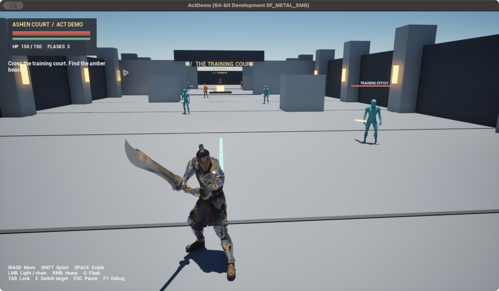
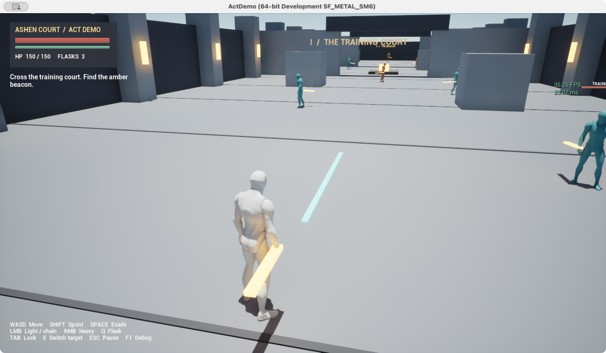

# ActDemo 验收记录

日期：2026-10-21。环境：Apple M3 Max / 36 GB，UE 5.8.2，Xcode 工具链、Mac SDK 15.5，arm64 Development。

## 当前证据

| 项目 | 结果 | 证据与范围 |
| --- | --- | --- |
| C++ Editor 编译 | 通过 | `ActDemo/Saved/Logs/KwangBuild.stdout.log`；运行时、动画实例与 Kwang 生成模块 |
| Mac Game 编译 | 通过 | `ActDemo/Saved/Logs/KwangPackageMac.log` 的 BUILD 阶段 |
| 资源生成 | 通过 | `BuildAssets.log` 中 `ACTDEMO_ASSETS_READY`；StateTree 编译、Montage/Notify、输入、UMG、地图和导航保存 |
| 游戏世界功能回归 | 43/43 通过 | `Smoke.log` 中 `ACTDEMO_SMOKE_COMPLETE checks=43 failures=0`；Editor executable 的 `-game -nullrhi` |
| 实际渲染启动 | 通过 | `KwangPackagedPlaytest.log`；独立包 Metal SM6，Kwang 模型、材质、持剑姿势正常 |
| PIE | 通过，有旧资源元数据警告 | `PIEAutomation.log` 中 `Result={Success} Name={PIE} Path={ActDemo.Editor.PIE}`；真实 `UEDPIE_0_L_AshenCourt` 世界、角色、UMG、暂停和六个 StateTree；NullRHI 自动检查 |
| Mac Cook / Stage / Package / Archive | 通过 | `KwangPackageMac.log` 中 `BUILD SUCCESSFUL`；`Builds/Mac/ActDemo.app`，约 1.1 GB，包含 Kwang |
| 独立包功能回归 | 43/43 通过 | `PackagedSmoke.stdout.log` 中 `ACTDEMO_SMOKE_COMPLETE checks=43 failures=0`；使用归档应用、Cook 后资源和 NullRHI |
| 独立包键鼠试玩 | 局部通过 | Kwang 版本正常打开 `.app`；移动、锁定、轻击击败 Scout、受击、滑步、施法恢复、死亡失败界面、暂停与 R 重试；`KwangPackagedPlaytest.log` 及下方截图 |
| 人工完整通关、5–10 分钟时长与性能 | 待验证 | 前一轮灰盒局部 `stat fps` 约 34–60 FPS；Kwang 版本尚未连续性能采样或正常键鼠完整通关 |
| Kwang | 已导入并完成玩家适配 | `KwangAssets.log` 中 `ACTDEMO_KWANG_READY`；12 个 ActDemo 自有适配资产，原包资源未修改 |

## 运行回归覆盖

测试 Actor 只在非 Shipping 构建显式传入 `-ActDemoSmoke` 时生成；正常玩家运行不会出现。测试在真实 UE 世界中调用现有角色、GAS、StateTree、感知、导航和动画逻辑。

- 玩家和六个敌人的初始化，StateTree 运行，NavMesh 可用。
- 体力不足拒绝技能，动作互斥，单次有效段不重复扣血。
- Montage Notify 控制闪避无敌帧，结束后清除；取消攻击后无残余伤害或 Busy 标签。
- 恢复道具扣次数并回生命；目标死亡与离开锁定范围时解锁。
- 检查点恢复、死亡打断、重试位置、剩余敌人数量、Boss 二阶段、胜利、重新开始、AIController 不累积。
- 暂停拒绝战斗请求，继续游戏不执行暂停前缓存动作。
- 实际视线感知、寻路进入近战距离并造成伤害；玩家离开感知范围后调查/搜寻、超时返回；噪声触发调查。
- 三段连击的输入缓存、26/30/38 三段伤害与第三段结束后的链条重置。
- Kwang 动画实例、所有动作骨架兼容、真实剑根/剑尖插槽跨度、重击单次 65 伤害及超出剑刃范围不扣血。

这些检查包含测试布置用的瞬移与直接属性修改，用于隔离故障。它们没有证明全关卡正常键鼠通关。

## Kwang 动画适配

玩家使用 Kwang_GDC 和自有 ABP_Kwang；Idle / Jog 四方向 / Sprint_Fwd 由 Direction × Speed BlendSpace 混合，DefaultSlot 播放 GAS 发起的全身动作。原包 AnimBP 强依赖 KwangPlayerCharacter 的连击事件，未接入运行时。

原挥剑在序列约 15–20% 处穿过角色正前方。第一次直接套模板窗口导致轻击、三连击和重击三项命中检查失败；已将蒙太奇拆成前摇 / 有效段 / 收招三段调速，并重新通过 43 项回归。玩家伤害只来自真实剑轨迹，原占位补偿 Sweep 仅保留在灰盒敌人。

受击动画原为 additive，在 ActDemo 自有副本上使用完整原始姿势。闪避用 Jump_Apex 姿势加滑步位移；恢复用 Cast 施法动作；两者仍是占位，不宣称已有翻滚和喝药动画。本次使用的攻击序列未开启 Root Motion，移动仍由 CharacterMovement 负责。

## 已修正的问题

- 资源生成时编辑器的异步加载导航锁导致 NavMesh 未生成；现在完成导航初始化、释放生成锁并构建保存。
- AI 停止距离加上胶囊半径后可能超出攻击范围；已将寻路接受距离收紧。
- 原生敌人血条在 NativeConstruct 才创建 WidgetTree，创建时机过晚；移至 RebuildWidget。
- Boss 血条与底部按键提示可能重叠，菜单按钮自动折行；已调整布局。
- 鼠标捕获时视角跳动、敌人血条远处堆叠；已限制镜头俯仰、降低视角增益并隐藏远处/被遮挡血条。
- 灰盒角色材质缺少 SkeletalMesh 用途标记；已在生成时设置，Cook 时使用正确 shader permutation。
- 初次归档缺少资源与运行库：Mac 现代 Xcode 流程需要显式 `-package`，只 Stage + Archive 会复制不完整的构建应用；脚本已补齐步骤与 `Contents/UE` 检查。
- 导航体积只含编辑器 Brush 多边形，Cook 后范围为零：现在使用 `FBSPOps::csgPrepMovingBrush` 生成 BSP 节点及运行时碰撞凸包，并在生成器中拒绝空凸包。独立包验证范围为 5750 × 1650 × 750 cm 半尺寸，AI 回归随之通过。
- 感知源注册由构造函数移至 BeginPlay，确保世界与 PerceptionSystem 已存在。

## 独立包试玩证据

### Kwang 版本

- `Screenshots/kwang-combat.png`：正常键鼠挥剑击败 Scout，玩家受击至 32/150，体力已消耗。
- `Screenshots/kwang-heal.png`：Q 触发持剑施法式恢复动作。
- `Screenshots/kwang-recovery.png`：恢复至 92/150，道具从 3 次减为 2 次，随后执行滑步；模型、材质和持剑姿势正常。

- `Screenshots/kwang-defeat.png`：受敌人攻击死亡后显示失败界面；R 重试后 Kwang、生命和道具重新初始化，见 `kwang-ready.png`。

### 前一轮 Manny 灰盒基线

- `Screenshots/packaged-pause.png`：Scout 锁定标记、敌人血条和暂停界面。
- `Screenshots/packaged-combat.png`：普通敌人倒下，玩家生命 133/150、体力消耗。
- `Screenshots/packaged-recovery.png`：恢复后生命 150/150，恢复道具由 3 次减为 2 次。

系统正常启动的应用日志位于 `~/Library/Containers/com.YourCompany.ActDemo/Data/Library/Logs/ActDemo/ActDemo.log`，Kwang 版本复制到工程 `Saved/Logs/KwangPackagedPlaytest.log`，前一轮灰盒记录为 `PackagedPlaytest.log`。Mac 应用沙盒下不能假设 `-abslog` 能写到工程外指定位置，因此独立包回归另外捕获 stdout 并以完成标记判定。

## 未隐藏的失败与运行警告

- Kwang 包含旧 `Paragon_Proto_Retarget`（Rig 类已不存在）元数据；PIE 报告 Success，附带该资源警告，直接使用同骨架序列不依赖旧 Retarget Rig。
- 只读检查原包示例 AnimBP 时，关联的 KwangPlayerCharacter 报旧 VR ResetOrientationAndPosition 节点编译错误。实际玩家不引用该示例蓝图，使用自有 AnimBP；未擅自修改原包示例。
- 首次生成受击副本时旧压缩缓存失效，引擎已重建并保存；后续游戏回归未出现压缩数据错误。

- 首次 Cook 出现一次引擎 Lumen shader worker 提前退出；关闭并行编辑器后串行重试通过。
- 从 shell 直接运行有画面的 app 内部二进制时，出现一次主线程 LLM / Binned3 初始化崩溃，尚未定位为项目逻辑问题。随后通过 macOS 正常打开归档 `.app`，连续试玩约 4 分钟并正常退出；未修改引擎内存分配器。当前推荐正常打开 `.app`，不提供内部二进制的交互启动脚本。
- 正常试玩日志未出现 `Error:`；仍有 AudioUnit 采样率查询、引擎 render-thread console variable 和退出期间 CrowdManager 找不到 NavMesh 的警告。退出前导航、AI 和战斗均已独立验证。

## 尚需保留的边界

玩家已接入 Kwang；普通敌人与 Boss 仍为 Manny 灰盒。闪避和恢复仍缺专用翻滚/喝药动作，音效继续使用合成占位音。会话内检查点不写盘，退出游戏后重新开始。不包含 Windows 或联网验收。

日志目录属于忽略的生成文件，可用 `Scripts/actdemo.sh` 重现。`assets -Force` 会覆盖本项目生成的地图、HUD 和配置，手工改装后不要直接执行。
