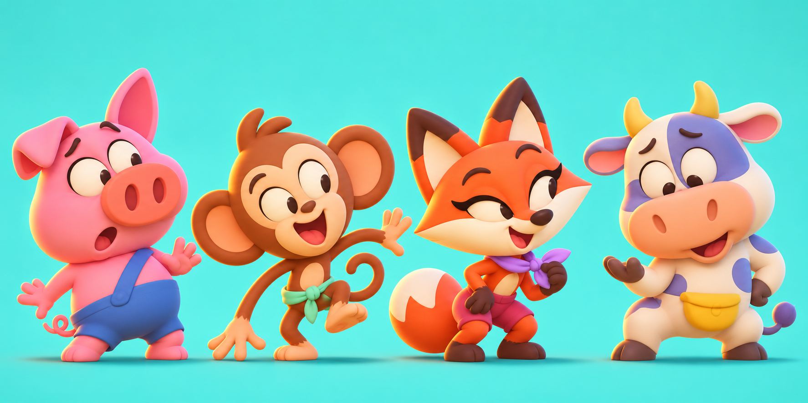
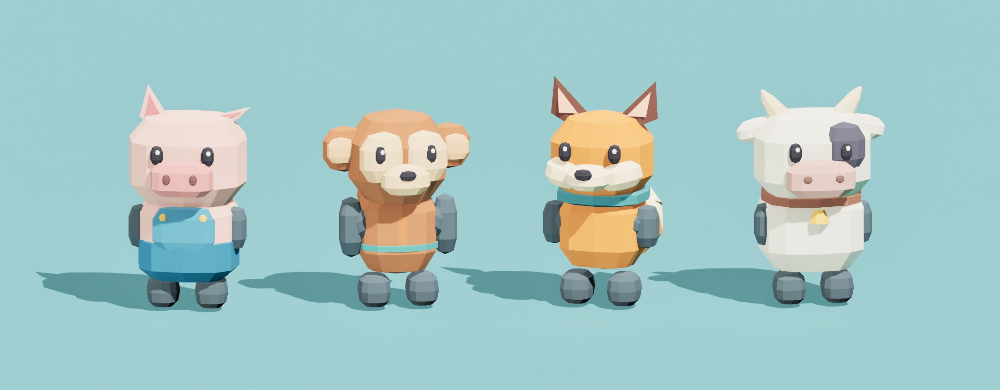

# 远征岛派对角色造型稿

首组四位是**猪、猴、女性狐狸、牛**，都能双足站立、双手挖土或搭在箱盖上。造型朝矮、软、动作夸张的游戏角色走。首组概念图里头部接近半身，约两头身。四位港口船员的现行模型沿用成年勘探员的体态和工装风格。模型按图保留短胸腔、短大腿和能抓握的手形，再用中性站姿和双手够箱的姿势核对臂长。把每只缩到远处队友的大小，优先认得出它是哪种动物、双手在做什么。

下图是首版四只角色在同一盏主灯下的 UE 图棚实拍，从左到右为小猪、猴子、狐狸和小牛。

在码头点击「选择角色」，可从正面略偏侧的位置查看自己的角色。点选即换装，队友会同步看到；返回房间时镜头拉回全队。四款都能自由重复选择。[码头实机选角](Screenshots/CharacterSelection.jpg) · [四款同机位近景](Screenshots/CharacterSelectionCrew.jpg)

## 港口船员实机版

修索猴的手腕垂到腰绳下方，圆耳、卷尾和灰绿修索夹克从背面也能认得。领航狐穿石板蓝短夹克，黄铜测向器挂在前襟，背后的海图筒与奶油色尾尖分开。铆工牛肩背宽，钝角朝两侧伸出，厚护腕和赭皮围裙将上身连成一块。

三位各自使用 28 骨模型、三档远近网格以及从本体单独导出的第一人称右手。左手按实际视角镜像，近景的露指手套、深色狐爪与牛蹄分别沿用角色材质。站立和挥拳从各自的腕踝位置起势，合撬时手臂够向相同的箱沿。码头换装、主岛和小游戏读取同一个角色选择。

[码头合影](Screenshots/HarbourCrewAtWork.jpg) · [旧版与本次选角对照](Screenshots/HarbourCrewComparison.jpg) · [三人动作实拍](Screenshots/HarbourCrewActions.mp4)

## 首版角色与动作设想

| 角色 | 缩小时要保住的轮廓 | 急停时会发生什么 |
|---|---|---|
| 猪 | 低矮横梨形，宽扁鼻盘、一折一立的耳朵，短短的腿从鼓起的肚腹下面露出来。蓝背带短裤是一整块色面。 | 脚已经刹住，肚子还往前晃，一只手赶紧往身侧撑。 |
| 猴 | 两只圆耳夹着浅色脸，胸腹小，两条弧形手臂垂得特别低，细尾在后面收弯。 | 手还探在前面，脚赶两小步追上去，空着的手向后划半圈。 |
| 女性狐狸 | 头呈楔形，黑耳尖、短尖吻、大蓬尾。耳形和眉眼能做出机灵的侧看，颈边一小块打结的色布把头和身子分开。 | 重心偏向一边时，尾巴向反方向摆；身子还在晃，眼睛已经盯住下一处箱缝。 |
| 牛 | 矮而宽的软方块头和身体，钝鼻、奶油色短角、一整块脸斑和小蹄脚。 | 两脚顿住、膝盖压低，脑袋和角慢半拍点一下，自己低头看了看。 |

## 主美选型与白模

推荐**哑光软胶动物**。从坑顶往下看，深色手爪在浅色土壁上挥一下，就能看清队友正在往哪边挖。跑动时脚先刹住，耳朵、肚皮或尾巴追半拍，重心会晃回脚底。泡棉布偶也能做出扑倒的喜感，松垂的长肢在坑沿容易盖住凿点。圆角木雕的动物形状很好认，躯干折转会继续显硬。首轮选软胶，用动作验证这两个取舍。

首版 UE 模型用宽阔的哑光切面表现圆肚、短腿和口鼻。小猪是粉皮、蓝色背带裤，猴子是肉桂棕、浅色脸和青绿腰带，狐狸用橙毛、深耳尖和奶油色尾尖，小牛用奶油白、深色眼斑和黄铜铃。四只的深灰手爪和脚掌在浅沙上都看得清。背部队章随队伍变色，从第三人称背面和坑顶可以看到。岛上的绿树、红船、橙砂斗、紫帆和蓝潮孔继续用各自的颜色。四种角色共用碰撞、移动、触及距离和合撬效率。

## 探险小猪可玩样板

小猪的新造型是一个常年在码头工作的成年勘探员。站姿稳，肩和前臂比头宽，裤脚压在工作靴上。猪吻略前伸，帽檐下的眼睑松松搭着，偶尔慢半拍看向工作点。苔绿色工作帽、褪色夹克、靛蓝背带裤和侧面的挎包让人从背面也能看出他的职业。

[主岛沉船旁实拍](Screenshots/ExpeditionDockSurveyorShore.jpg) · [同机位新旧造型](Screenshots/ExpeditionDockSurveyorIteration.jpg) · [Mac 实机近景与肩后视角](Screenshots/ExpeditionPigReview.jpg) · [跑停、出拳、投土与合撬短片](Screenshots/ExpeditionPigPunch.mp4) · [造型概念稿](Screenshots/ExpeditionDockSurveyorConcept.png)

造型稿用侧光照出帽檐、面颊和猪吻的转折，大面料保持哑光，金属扣只在转折处见光。进游戏后可以在码头检查正脸，在主岛按 V 切换肩后和第一人称，观察收拳、落拳和合撬时双蹄的方向。[低多边形造型与光照参考](https://sundaysundae.co/how-to-make-low-poly-look-good/)

## 给模型与动作生成的交接

**先交一只小猪。** 中性、双脚同高的 A 姿，正、侧、背三视图保持同一比例。掌心能摊开，拇指能扣住箱沿。分出队章材质区，以脚底为根，四种动物共用髋、脊椎和四肢骨架，耳尾按物种加表现骨。第二只用猴检查长臂与同一个箱沿的接触。UE 按现有宽 80、高 180 厘米的角色胶囊，以及 90 × 68 × 64 厘米的箱子校准。肩镜头跟随胶囊，角色摇晃时画面保持水平。[当前角色与镜头](../ActDemo/Source/ActDemo/Voxel/VoxelCharacter.cpp) · [箱体规格](../ActDemo/Source/ActDemo/Island/IslandRules.h)

首批原地动画需要站立、跑与急停、起跳与落地。挖和丢各有一段能连续播放的动作，标出凿中和土团脱手帧。地面搭台和砸对手都用同一次低手抛；向脚边丢时，爪子顺瞄准方向压低。醒来的动物还需要一段能立刻接挖掘的矮身移动。

| 动作 | 主镜头要看见什么 |
|---|---|
| 左键挖 | 轻点松手向准星打一拳。按住时后手收向腰侧、前手护胸，移动时腿继续迈步。满蓄后松手，脚蹬地、转腰、送肩出拳，再收回站稳。 |
| 右键丢土 | 一爪后摆、向前低抛，松手即回到下次挥臂的起势。砸到对手能看到泥点；朝脚边丢同一团，落地摊宽成能踩的土面。 |
| 中弹、晕倒、被盖住 | 前两团用沾泥和晃耳读出连击，脚步照常。第三团让动物蜷成一团倒下。继续落土时，从身侧逐渐盖到头顶，敌方星星提示随身体一同被土挡住。 |
| 醒来掏洞 | 先睁眼、收起四肢，立即能朝准星挖。猫腰调头、侧挪和斜向下挖都从同一矮身起势进入；有足够净高再舒展开。贴地镜头让玩家看清哪一面是可挖的土。 |
| 左键单击箱盖独撬、合撬、接替 | 猪双手扣住箱沿，蹲低往后坐。猴从另一侧把手搭在错开的握点，同步拉盖。猪中途跑开，猴的肩膀晃一下，手还扣在盖上，继续撬。 |

**首段白模样片**从搜索坑边开始。猴连续丢中三团，小猪晕倒；再补两团，土盖合拢。画面同时看地面与小猪的视角：猴守在土包上，小猪醒来已在向坑壁左侧挖。等小猪从侧面破土、抛回一团，猴才看见出口。第二个镜头让小猪在坑里朝脚边丢同样的土，踩上去，再沿坑壁丢出下一级。最后两只同队动物从两侧够到箱盖，检验合撬站位。首版白模用四个带平面切角的静态雕塑表现猪、猴、狐和牛。探险小猪已改用骨骼模型，沿用同样的握点和比例。[操作与数值](ExpeditionPartyProposal.md) · [现有合撬与夺锁规则](../ActDemo/Source/ActDemo/Island/IslandChestLock.cpp)

本轮造型图的内置 ImageGen 提示词

A single joyful wide landscape concept lineup for a colorful slapstick island treasure PARTY VIDEOGAME. Four absolutely original, highly stylized, chunky BIPEDAL CARTOON animals: PIG, MONKEY, female FOX, COW in this exact left-to-right order. Art direction is graphic rubber-hose animation translated into beautiful simple 3D gameplay models. Extreme squash-and-stretch proportions, individually sculpted head shapes, absolutely tiny bodies, stub legs and soft paddle hands with thumbs; just 2.2 to 2.6 heads tall including feet. NO realistic people, NO adult humanoid bodies or outfits. Head, ears and expressive snout occupy nearly half their height. Two arms and two feet each, full bodies in frame from ears to feet. Broad negative space and one baseline. Matte gumdrop-like clean materials, broad curved bevels, playful candy-bright blocks of color, soft turquoise sky studio backdrop, warm rim light and little contact shadows. The lighting should look like a frame of a polished indie multiplayer game. Designed to read at 80 pixels! Funny, curious, disarmingly expressive. Their asymmetrical off-balance poses and different weight distribution tell the joke, while avoiding generic round mascot costumes. Each is a real cartoon animal with integrated muzzle, hooves or paws, tail and ears.
LEFT: a bubblegum-pink biped pig, broad rounded-trapezoid potato body, one folded triangular ear and one upright, huge flat squashed-coral oval pig snout with two graphic nostrils, short feet turning out and tiniest curly tail. Simple blue short dungarees with only one wide strap and no hardware, no shirt or shoes. Belly has come to a halt but upper half swings backwards, one paw held out to steady himself, a funny surprised sideways expression.
SECOND: a cinnamon monkey with a teardrop head, two huge disk ears, cream heart-shaped face, simple curved elastic arms long relative to its little body and bent legs. Tiny mint waist tie and a skinny curved tail, one foot just hovering, one arm reaching down and the other counterbalancing. Friendly curious expression. Absolutely compact, body NOT slender adult.
THIRD: a female red fox with a broad angular wedge head, two large dark-tipped triangular ears, clever short pointed fox muzzle, pale cream cheeks, big white-tipped low brush tail, and expressive curved cartoon eyes. One knot of a lilac short neckerchief to one side, raspberry shorts, simple mitten-like dark paws. Same really short chunky unisex biped proportions as the other three. Crouching slightly and peering playfully sideways holding the tip of her neckerchief. Express femininity through agile acting and eye shape, no mature human anatomy, no human hairstyle or styled makeup.
RIGHT: a creamy white-and-periwinkle patched biped cow, low broad softly square head and squared off compact body, soft big blunt warm-peach muzzle, two short butter-colored nub horns, tiny hooves, wide short arms, small tufted tail, mustard-yellow little waist pouch. Rounded block shape, no visible muscles. Wide stance and knees squashing, looking down sheepishly at an outstretched upturned hand. Large simple graphic patch over one eye. Give each character different readable eye expressions; no baby pacifiers, blush stickers, plush fabric, glassy doll eyes, identical mascot faces or fake fur suits. No collars or workwear beyond the specified tiny outfit pieces, no realistic fur fibers or fabric texture, detailed seams, belts full of gear, boots, uniforms, printed jersey numbers, standing-like-fashion-model postures, text, title, labels or watermark. This must look like four comical little playable troublemakers; clear, bold sculptural shapes.

